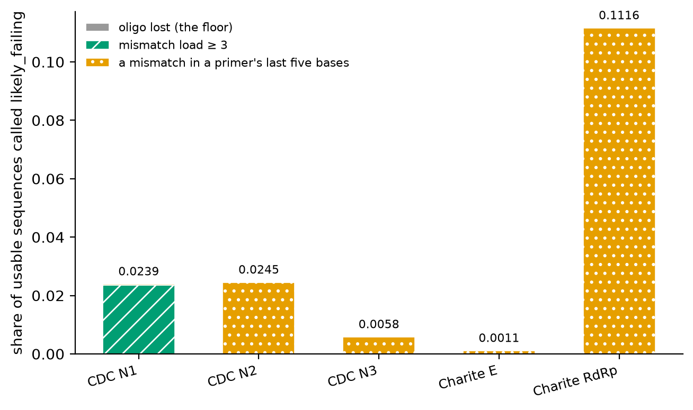
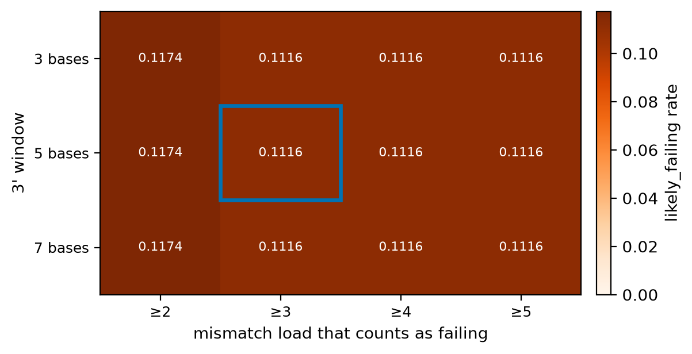
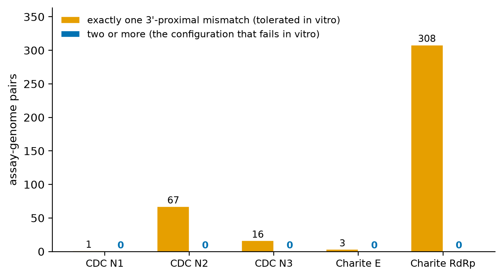
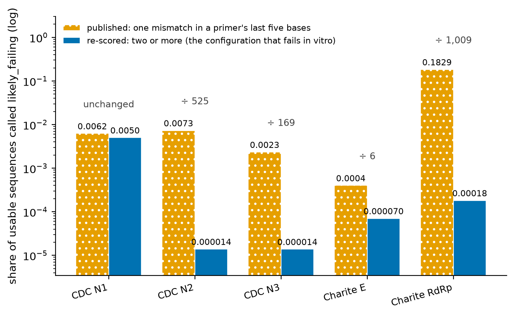

# Abstract

A PCR assay fails silently when its target mutates under an oligo, because a failed
amplification looks exactly like a negative sample. Public tools exist to watch for this —
NEB's Primer Monitor, assayM, an automated validation website, PCR_strainer — and all of
them report the **current** mismatch picture against a sequence database.

We align five published SARS-CoV-2 assays against **291,827 dated GenBank genomes** from
2020 to 2026 and report by collection quarter, with a Kish effective sample size per
quarter so that a rate resting on one submission is visible as such. Two results follow
from reporting over time rather than at a point. **Two assays lost their exact match
entirely** (99.9% and 98.4% down to 0.0%), and neither mutation sits where it would stop
the reaction. And **Charité RdRp ends the series at 86.8% exact match while having been
5.1% exact, with 94.9% of sequences carrying a 3′-terminal mutation, in 2023-Q3** — an
assay that looks healthy at both ends of a series and was unusable in the middle. An
endpoint-only report cannot see that; ours would not have either, before the worst
quarter was reported beside the endpoints.

A 2025 wet-lab study [@wetlab2025] tested 16 assays against over 200 mismatched templates
in vitro. We take it as a measurement problem and apply it to our own rule. The result is
unflattering and is published as a headline rather than a caveat. The only clause a bench
would not dispute — an oligo with no binding site, which cannot prime — **fires for no
sequence in either corpus**: not one of the 2,765 genomes and not one of the 291,827,
once the single partial deposit that has no such region to lose is counted separately
(§5). Worse, the clause that produces almost all of the rate is
contradicted by the source it derives from: Lefever et al. [@lefever2013] license
tolerating single mismatches *more than* 5 bases from a 3′ end, which our rule inverts
into a failure prediction for single mismatches *within* 5 bases. Across 2,765 genomes
and five assays, **every one of the 395 3′-proximal hits is a single mismatch and none is
a pair** — and a single 3′-proximal mismatch is the one configuration Otwell et al.
measured directly, at about one cycle of Ct shift and no false negative. At 291,827
genomes the pair does appear, **52 times in 54,755 3′-proximal hits, 0.095% of them**
(§4.5), which puts a measured base rate under the surveillance claim instead of an
absence. We therefore
withdraw our most alarming number as a failure prediction — Charité RdRp's **18.29%** on
the 291,827-genome corpus, 11.16% on the 2,765-genome one, which fall to 0.00018 and
0.0000 when clause 2 requires the two mismatches the bench measured — and reframe the
category as **surveillance**: those genomes are one mutation away from a configuration
that does have wet-lab evidence behind it (§4, §4.5).

# 1. Introduction

Existing primer-monitoring tools answer "which variants currently carry a mismatch under
this oligo". That is the right question for a laboratory choosing an assay this week, and
the wrong one for deciding whether an assay was dependable over a period. The two come
apart, and the gap is this paper's subject.

**Related work.** An automated validation website screens deployed assays against genome
databases using ThermonucleotideBLAST, reporting per-assay recall and mismatch
heatmaps [@bioinformatics2020]. Its definition of a predicted false negative is worth
quoting, because it is close to the rule this paper takes apart: any one of three or more
mismatches in an oligo/target alignment, a predicted melting temperature below 40°C, or
**one or more mismatches in the last two 3′ positions of a primer**, the last attributed to
Li et al. (2004). Two of those three are the clauses examined in §4 — a mismatch-count
threshold and a 3′-proximity rule — arrived at independently and set at a comparable place,
which is why this paper's question is about the family of rules and not about one
implementation. assayM is a web application for monitoring mutations in the
primer and probe sequences published by the WHO, or in custom ones, across globally
available SARS-CoV-2 genome datasets [@assaym]. NEB's Primer Monitor tracks **NCBI
GenBank** sequences against user-supplied primer sets and notifies a subscriber when a
variant overlapping a primer set passes a threshold fraction of observed sequences in a
region; it was released after FDA guidance urged developers to monitor primer alignment
[@primermonitor]. PCR_strainer examined 15
primer/probe sets from eight laboratory-developed tests and found most with no mismatches
in over 98% of genomes, with three sets problematic [@pcrstrainer]. A 2025 wet-lab study
tested assays in vitro and found most performed well despite mismatches, measured by PCR
efficiency and Ct shift — concluding that in-silico false-negative predictions may
overstate risk [@wetlab2025]. A 2021 study re-evaluated eleven primer/probe sets against
84,305 genomes collected between June 2020 and January 2021 and reported the China CDC
N-gene assay's inclusivity continuing to fall as new mismatches appeared — 63.89%, down
from 86.03% in April and 74.54% in May 2020 — while the others held above 99%
[@genes2021]. BioFire runs the only ongoing programme of this kind we
found: monthly in-silico screening that had covered 12,744,136 sequences by March 2023
[@biofire2023].

**What is new here, stated narrowly.** Time series of this kind exist — [@genes2021] is
one, over seven months and eleven assays, and [@biofire2023] is a continuing one. The
distinction this paper draws is between **removing duplicates** and **weighting for
independence**, and it is a real distinction rather than a convenient one.

[@genes2021] does deduplicate, and thoroughly: it discards genomes carrying more than one
undetermined base, leaving 154,602, then collapses identical sequences with CD-HIT-EST at
a 1.0 identity cut-off and keeps one representative of each cluster — **84,305 of 154,602,
so 45.5% of its high-quality set was an exact duplicate of something else**. That is not
raw sequence counting and this paper does not claim it is. What it does not do is treat the
survivors as anything other than equally independent: two genomes from one submission
differing at a single base are two observations, and no submitter-level grouping,
cluster weighting or effective sample size appears anywhere in its methods or results.
[@bioinformatics2020] goes less far again — its only deduplication is across databases,
preferring the GISAID copy of a genome also in GenBank — and its recall is computed over
every genome as one observation.

Exact-duplicate removal and independence weighting answer different questions, and the
distance between them is measurable on this corpus. The first stops one sequence being
counted twice; the second asks how many *independent* observations a rate rests on.
Applying [@genes2021]'s own procedure to 2024-Q1 here — collapse byte-identical genomes,
keep one of each — takes **159 sequences to 153**, a reduction of 3.8%. That quarter's Kish
effective sample size is **1.1**. Deduplication removes six sequences; independence
weighting says the remaining 153 are worth about one observation between them, because they
are near-identical deposits from four submitter groups rather than one hundred and
fifty-three independent looks at a virus population. Across the whole 2,765-genome corpus
only 4.0% of sequences are an exact duplicate of another, so this gap is not an artefact of
one quarter: at corpus scale exact-duplicate removal has almost nothing to remove, and the
independence problem is almost entirely untouched by it.

Neither prior series publishes a per-period effective sample size, and neither states a
floor a period must clear before it may carry an endpoint. Those are this paper's methodological contribution, over a
span — 2020 to 2026 — roughly ten times the longer of the two. The claim that no time
series existed appeared in an earlier draft and was false; it is the fourth absence-based
claim in this author's related work to fail on a second literature pass. A fifth has since
failed: that [@genes2021] reported no independence structure at all, which reading the
article disproved — it deduplicates exactly, it simply does not weight. The pattern, not
the individual corrections, is recorded in the citation note. An absence is the one kind of
claim a search summary cannot establish, and this fifth one was written from a search
summary and fell the moment the article itself was read.

**Contributions.**

1. A quarterly series over 291,827 dated genomes with **Kish effective sample size** per
   quarter, and an independence floor an endpoint must clear (§2, §3).
2. The finding that **endpoint reporting hides the middle**, with Charité RdRp as the case
   (§3).
3. A **decomposition of our own failure rule** showing that its bench-defensible clause
   never fires, taken directly from the wet-lab criticism (§4).

# 2. Method

Each oligo is aligned with IUPAC codes read as sets **on both sides**: a primer `R` matches
`A` and `G`, and a subject `R` where the primer wants `A` is ambiguous, not a mismatch.
Overstating drift is the error this work has had to correct more than once.

An unknown base under an oligo is **missing data**, excluded from rates and reported, so a
change in sequencing quality does not appear as viral drift. A record with no usable
collection date is dropped and counted, never defaulted to today.

Each sequence is scored `perfect`, `drifted` (mismatched, expected to amplify),
`likely_failing`, or `unknown`. The 3′ window applies only to primers: a hydrolysis probe
is blocked at its 3′ end and never extended.

**Independence.** Sequences from one submission are not independent observations, so each
quarter is grouped by (country, accession block) and given a Kish effective sample size
$n_\text{eff} = n^2 / \sum n_i^2$. A quarter needs 25 usable sequences **and** 10
independent submitter groups to carry an endpoint. Median effective $n$ across the 28
reliable quarters is 82.3, against about 4 on a 2,765-genome subset — which is why the
large corpus exists. Without the floor, the series would have ended at 2026-Q4: 67 usable
sequences from 7 groups, $n_\text{eff} = 1.5$, and CDC N2 reported as down 0.9 points
instead of 19.3.

# 3. Results

Exact match, first to last quarter able to carry an endpoint:

| Assay | 2020-Q1 | 2026-Q3 | Change | Likely failing at the end | Worst quarter |
|---|---:|---:|---:|---:|---|
| Charité E | 99.9% | **0.0%** | −99.9 | 0.0% | 0.2% (2023-Q3) |
| CDC N1 | 98.4% | **0.0%** | −98.4 | 5.8% | 5.8% (2026-Q3) |
| CDC N2 | 99.4% | 80.1% | −19.3 | 7.6% | **30.4% (2026-Q2)** |
| Charité RdRp | 99.9% | 86.8% | −13.0 | 13.1% | **94.9% (2023-Q3)** |
| CDC N3 *(retired)* | 98.8% | 86.1% | −12.7 | 0.7% | 0.8% (2026-Q2) |

**Charité RdRp is the result.** Its endpoints say 86.8% exact and 13.1% likely failing —
slow erosion. In 2023-Q3 it was 5.1% exact and 94.9% likely failing over 469 usable
sequences from 57 submitter groups ($n_\text{eff} = 14.2$), so not an artefact of one
submission. Delta's NSP12
G671S sits at the 3′ terminus of its forward primer; the rate recovered when Omicron
displaced Delta. **An assay can be fine at both ends of a series and have been unusable in
the middle**, which is what an endpoint-only tool cannot report and why the worst
qualifying quarter is published beside the endpoints.

The same four oligos, at the same base of each, appear independently in a corpus 105 times
smaller, with shares differing because the year mixes differ — not because the finding
moved.

# 4. How much of `likely_failing` is the rule

This section was rewritten after its two load-bearing references were read in full rather
than quoted from search summaries. Doing so contradicted the tool's most alarming
verdict, and the contradiction is reported here rather than worked around.

`likely_failing` has three clauses: (1) an oligo with no binding site, (2) a mismatch
within 5 bases of a primer's 3′ end, (3) ≥3 mismatches across the assay. Clause 1 is the
only one a bench would not dispute.

## 4.1 What the wet-lab literature actually licenses

Lefever et al. [@lefever2013] is the origin of the 5-base window. Their conclusion is
that *"single mismatches located >5 bp from the 3′ end have a moderate effect on qPCR
amplification and can be tolerated."* That is a statement about mismatches **outside** the
window. It does not say that a single mismatch inside the window causes failure, and
clause 2 asserts the converse of what the source supports.

Their blocking threshold is also far above clause 3: *"≥4 mismatches in a single primer"*
blocks a reaction completely, as does three in one primer with two in the other. Clause 3
fires at three mismatches **anywhere across the assay**, which is below the published
threshold for a single primer.

**The narrower form of the rule has a stranger provenance still.** The public validation
website of [@bioinformatics2020] uses a two-base window rather than five, and states its
source: a predicted false negative includes *"one or more mismatches in the last two 3′
positions of a primer that are reported by Li et al. (2004) to inhibit detection by
increasing detection Ct ≥2"*. That citation is [@taqmama] — *Genotyping with TaqMAMA* —
and TaqMAMA is not a study of assay robustness. It is an **allele-discrimination genotyping
method**: TaqMan combined with the Mismatch Amplification Mutation Assay, in which a
3′-terminal mismatch is **deliberately engineered** so that the primer fails on the allele
it is not meant to detect. Its abstract describes using plasmids that model every type of
polymorphism *"to understand the relationship between TaqMAMA primer/template mismatches
and their strength of allelic discrimination"*, and offers the result as a way to *"improve
allelic discrimination ... through directed use of nucleotide mismatches"*.

So the Ct ≥2 is a **design target measured on plasmids**: how well an intentional terminal
mismatch suppresses the wrong allele, which for a genotyping assay is the thing you want to
maximise. It is read, two steps later, as the threshold at which a naturally occurring
mismatch in a diagnostic assay should be called a predicted false negative. The quantity is
the same number and the claim is close to its reverse — an engineered mismatch chosen for
maximal suppression, on a plasmid, standing in for an incidental one on a viral genome.

This is the clearest instance of the pattern this section is about, and it is not this
paper's rule: `likely_failing` uses five bases, not two. It is offered because it shows the
mechanism by which such thresholds travel. Neither window was calibrated against a
diagnostic bench; one is a conclusion read backwards and the other is a genotyping design
guide read sideways.

Otwell et al. [@wetlab2025] then tested 16 assays against over 200 synthetic templates in
vitro, and their results separate position from count in a way clause 2 cannot:

| configuration tested | observed effect |
|---|---|
| single reverse-primer mismatch ~1 nt from the 3′ end (BVP 501Y) | ≈1 cycle Ct shift, **no false negative** |
| two forward-primer mismatches, same assay | 9–12 cycle shift, **genuine false negative** |
| three mismatches within the last four 3′ nucleotides (C3 ORF3a) | failure below 5,000 copies, Ct shift > 15 |
| up to four reverse-primer mismatches, not 3′-clustered (C4 ORF8) | 1–2 cycle shift |
| three 5′-end forward-primer mismatches (China_N) | comparable to control despite ≈7 °C predicted Tm drop |

A single 3′-proximal mismatch is tolerated; a cluster is not. Their overall conclusion is
also more balanced than this paper's earlier draft reported: they write that assays are
*"more robust to genetic drift than anticipated"* — but add *"or at least can be more
robust than predicted, depending on the specific wet lab conditions used"*, and they
record the **opposite** error too, templates not flagged in silico that performed poorly.
The earlier draft cited them for "in-silico predictions overstate risk" alone, which took
one half of a two-sided finding.

## 4.2 Re-scoring under a rule the evidence supports

A fourth rule shape was added: clause 2 requires **two or more** mismatches in the 3′
window rather than one. Re-scoring the 2,765-genome corpus, 3 windows × 4 loads × 4
shapes:

| Assay | published | **clustered 3′ (≥2)** | without clause 2 | clause 1 alone |
|---|---:|---:|---:|---:|
| CDC N1 | 0.0239 | 0.0235 | 0.0235 | **0.0000** |
| CDC N2 | 0.0245 | **0.0000** | 0.0000 | **0.0000** |
| CDC N3 | 0.0058 | **0.0000** | 0.0000 | **0.0000** |
| Charité E | 0.0011 | **0.0000** | 0.0000 | **0.0000** |
| Charité RdRp | 0.1116 | **0.0000** | 0.0000 | **0.0000** |

The clustered column is identical to dropping clause 2 altogether, which is not a
coincidence and not an artefact — at this corpus size. §4.5 repeats the re-scoring over
291,827 genomes, where the two columns part company.

Charité RdRp's two middle cells read **0.0004** until this grid was run at full scale, and
the correction is worth stating because of how it was found rather than for its size. The
grid re-implements the three clauses so it can vary the window and the load without
re-aligning, and it had implemented the mismatch-load clause as `total >= load`, omitting
the per-assay baseline the production rule subtracts — `baseline_for(assay)`, each assay's
own mismatch count against the 2019 reference, which is **1 for Charité RdRp and 0 for every
other assay**. `baseline_for`'s own docstring says that scoring RdRp against zero "would
report it as broken for every sequence ever collected, including the reference itself", and
that is what the grid did, for that one assay. On this corpus it was off by a single genome
and invisible: the published rate is dominated by clause 2, and the load clause only shows
once clause 2 is removed, which is exactly the two cells above. At 291,827 genomes the same
line put RdRp's load clause at 406 where the pipeline says 4. Two implementations of one
rule had disagreed from the start and nothing compared them;
`tests/test_grid_agrees_with_the_pipeline.py` now checks five identities per assay per
corpus — population, published rule, load clause, clustered clause and clause 1 — against
`results/drift*.json`, and two of them failed before the fix. The distribution of 3′-proximal mismatch counts over all
2,765 genomes is:

| Assay | 0 in window | 1 | ≥2 |
|---|---:|---:|---:|
| CDC N1 | 2,718 | 1 | **0** |
| CDC N2 | 2,663 | 67 | **0** |
| CDC N3 | 2,745 | 16 | **0** |
| Charité E | 2,744 | 3 | **0** |
| Charité RdRp | 2,451 | 308 | **0** |

**No genome in this corpus carries two mismatches in a 3′ window.** Every one of the 395
3′-proximal hits — including all 308 that produce Charité RdRp's 11.16% — is a *single*
mismatch near a 3′ terminus. That is precisely the configuration Otwell et al. measured
directly and found to cost about one cycle.

At clause 3's load raised to 4, Lefever's single-primer blocking threshold, Charité
RdRp's rate is **0.0000 at every window value** (n = 2,759, 95% CI [0, 0.0014]).

## 4.3 What follows

The headline `likely_failing` rate for Charité RdRp is composed **entirely** of a
configuration for which the only direct in-vitro measurement available reports no false
negative. We therefore do not claim that 11.16% of genomes defeat the RdRp assay, and the
tool's own most alarming number is withdrawn as a failure prediction.

The category is kept rather than deleted, because the positional observation is real and
is the thing worth surveilling: G15451A one base from a 3′ terminus did occur, it did
spread, and a *second* mutation arriving in the same window would move those 308 genomes
into the configuration that Otwell et al. found does cause false negatives. The honest
framing is **surveillance, not prediction** — `likely_failing` marks assay–genome pairs
one mutation away from a configuration with wet-lab evidence behind it, and that is a
useful thing to watch and a different claim from the one the name makes.

Accordingly the tool now reports the clustered rate beside the published one, and this
paper's abstract and §3 are to be read with 4.3 in force. §4.5 carries the whole argument
to the 291,827-genome corpus, where the rate being withdrawn is 0.1829 rather than 0.1116
and the conclusion is the same.

## 4.4 Figures

All four rebuild via `python research/sensitivity.py && python research/run_all.py`.
Figures 1 to 3 are over the 2,765-genome corpus; Figure 4 is the published setting over all
291,827 genomes. Only the 3′ **window** costs a pass over the corpus — the count is produced
during alignment and `Hit` keeps the count rather than the positions, so a window cannot be
varied after the fact, while the load and the shape are re-scored from the aligned rows in
memory. The grid is therefore three passes over whichever corpus it is run on, not twelve;
this paragraph and §5 both said twelve until the script was read again.

**Figure 1.** Which clause of the `likely_failing` rule produces the published rate, at
the published settings (3′ window 5, mismatch load 3), about 2,719 usable sequences per
assay. The grey floor is the only clause a bench would not dispute — an oligo with no
binding site cannot prime — and it is **zero for all five assays**. For Charité RdRp the
3′-window clause alone accounts for 0.1116 of a 0.1116 rate — all of it.

**Figure 2.** `likely_failing` across both thresholds, for the two assays that answer
differently. The blue box is the published setting; each panel carries its own colour scale
and the value is printed in every cell. Neither threshold was calibrated against a bench,
and the consequence is **opposite in the two panels**. Charité RdRp's rate does not move at
all across the twelve choices: every flagged genome carries a single mismatch inside the
innermost three bases, so widening the window adds nothing and the load clause fires on none
of them. CDC N1's runs from 0.3924 to 0.0004, **a factor of about 981**, because its rate is
made of mismatch load where RdRp's is made of 3′-proximal position. The published rule
reports both as the same kind of finding. Both panels are the smaller corpus, as figures 1
to 3 are; §5 re-runs the whole grid over the large one, where RdRp's invariance holds
exactly and the contrast survives with CDC N1's factor several times smaller. This figure
drew RdRp alone until the grid's
baseline bug was fixed, at which point RdRp's twelve cells became identical and a
single-panel figure captioned "the thresholds are uncalibrated" showed a uniform block —
which reads as the opposite, that the choice does not matter.

**Figure 3.** Mismatches falling inside a primer's 3′ window, per assay, over 2,765
genomes: **395 assay–genome pairs carry exactly one and none carries two or more.** The
rule fires on one. The only direct in-vitro measurement of one reports about a single
cycle of Ct shift and no false negative; two produce a 9–12 cycle shift and a real one.
Charité RdRp's 11.16% is composed entirely of the left-hand bars.

**Figure 4.** The re-scoring of section 4.5 over all 291,827 genomes, at the published settings, 281,456 to 289,945 usable sequences per assay. Clause 1 - an oligo with no binding site, the only clause a bench would not dispute - is zero for all five and so does not appear. Requiring **two** 3'-proximal mismatches instead of one divides Charité RdRp's rate by 1,009 and leaves CDC N1's essentially unchanged (0.0062 to 0.0050), because N1's rate is mismatch load and RdRp's is single 3'-proximal mismatches. The pair does occur at this corpus size - 52 times in 54,755 3'-proximal hits - which is what makes the surveillance framing a measured claim rather than an absence.

## 4.5 The same re-scoring over 291,827 genomes

§4.2 is scoped to the 2,765-genome corpus, and its load-bearing sentence — no genome
carries two mismatches in a 3′ window — is the kind of claim a hundredfold larger corpus
is apt to overturn. It does, and the overturning is the more useful result.

Re-scoring all 291,827 genomes at the published settings (3′ window 5, mismatch load 3):

| Assay | usable | published | **clustered 3′ (≥2)** | without clause 2 | clause 1 alone |
|---|---:|---:|---:|---:|---:|
| CDC N1 | 289,287 | 0.0062 | 0.0050 | 0.0050 | **0.0000** |
| CDC N2 | 288,108 | 0.0073 | 0.000014 | 0.000014 | **0.0000** |
| CDC N3 | 289,945 | 0.0023 | 0.000014 | 0.000014 | **0.0000** |
| Charité E | 285,298 | 0.0004 | 0.000070 | 0.000070 | **0.0000** |
| Charité RdRp | 281,456 | 0.1829 | **0.00018** | 0.000014 | **0.0000** |

Three things hold across the two corpora and one does not.

**Clause 1 still fires for nothing.** Zero for all five assays over 281,456 to 289,945
usable sequences each — the one clause with uncontested wet-lab backing contributes
nothing to the published rate at either scale. The single record that would have fired it,
a 2,859-base partial deposit, is now counted as `region_absent` rather than as a lost
oligo (§5), because a fragment that never contained the target region cannot be evidence
that the region was lost.

**The published rate is still almost entirely clause 2 at one mismatch.** Charité RdRp's
0.1829 is 51,465 genomes, and all 51,465 of them are 3′-proximal hits. Re-scoring clause 2
at two mismatches takes that rate to 0.00018, a factor of a thousand. §4.3's withdrawal
therefore does not rest on the small corpus; it is the same withdrawal, over a hundred times as
many genomes.

**The clustered column is a union, and it was briefly a sum.** The clustered rule fires
on a lost oligo, *or* a 3′-proximal pair, *or* a severe mismatch load, and
`AssayResult.clustered_failing` evaluates exactly that; `summarise` counts it as
`failing_clustered` and the analysis script exports it. Figure 4 nevertheless rebuilt the
quantity as `three_prime_pair + severe_load`, which double-counts any genome in two clauses
and omits any that lost an oligo outright. Over the 2,765-genome corpus the sum and the
union agree for all five assays, because nothing there is in two clauses at once — which is
why this survived §4.2 — and over 291,827 they do not: the sum over-counts CDC N1 by 4
genomes and Charité RdRp by 1. **The table above is unaffected**; every cell rounds the same
at the precision it publishes, which is the second reason nothing noticed. What moved is
figure 4's caption, from "divides RdRp's rate by 990" to a factor of **1,009**. The figure
now reads `failing_clustered`, and `tests/test_clustered_is_the_union_not_the_sum.py`
forbids anything outside the library turning the two counters into a clustered rate again.

**Pairs exist, and they are rare in a way worth quantifying.** The column that was all
zeroes in §4.2 is not:

| Assay | 3′-proximal hits | of which a pair | share |
|---|---:|---:|---:|
| CDC N1 | 423 | 4 | 0.95% |
| CDC N2 | 2,097 | 0 | 0% |
| CDC N3 | 672 | 0 | 0% |
| Charité E | 98 | 0 | 0% |
| Charité RdRp | 51,465 | 48 | 0.093% |

52 pairs in 54,755 3′-proximal hits, and 52 in 1,434,094 assay–genome evaluations —
0.0036% of evaluations.

**An external number, and why it is not a validation.** BioFire's ongoing surveillance
reports 481 of 12,744,136 sequences, **0.0038%**, carrying "paired mismatches of concern"
[@biofire2023]. The two figures agree to one significant figure and they are not the same
quantity. Theirs is a 3′-half mismatch in *both* assays of a two-assay panel; ours is two
mismatches inside one primer's 3′ window. An agreement in magnitude between two different
definitions is a coincidence until someone computes one of them on the other's corpus,
and this paper does not. What does carry over is their design argument: a panel that calls
positive on either of two independent targets tolerates a mismatch that would be
diagnostic failure for a single-target test. All five assays studied here are
single-target laboratory-developed tests, so the mitigation that makes 0.0038% tolerable
for BioFire does not apply to them — which is a reason to watch the configuration, and
the same conclusion §4.3 reaches from the other direction.

This strengthens §4.3 rather than weakening it: the configuration Otwell et al. found does
cause false negatives is **reachable** — it was reached, by two assays, in six quarters —
and its base rate among the genomes `likely_failing` flags is about one in a thousand.
That is what "one mutation away" is worth as a number, and it is a figure only a corpus of
this size can supply. The RdRp pairs are concentrated in 2021-Q3 and 2021-Q4, 46 of the
48, the Delta quarters in which G15451A was spreading — which is the mechanism §4.3
describes, arriving at the 3′ terminus a second time.

**What changes is the arithmetic of the clustered column.** In §4.2 the clustered rate
equalled the rate with clause 2 dropped, because there were no pairs for clause 2 to
contribute. Here the two part for Charité RdRp — 0.00018 against 0.000014, 48 pairs
against 4 severe-load genomes — which is why the tool now carries `three_prime_pair` and
`severe_load` as separate counters rather than one `failing_clustered` total. A union
count cannot say which clause fired, and the published 0.1829 was taken apart only
because each clause is counted on its own.

## 4.6 A second opinion that is not a rule of thumb

Everything above argues about a threshold by argument. `THREE_PRIME_WINDOW = 5` is a
primer-design convention, §4.1 shows the wet-lab literature licenses something weaker than
the code applies, and §4.2 re-scores under the weaker reading. None of that compares the
rule against a quantity measured independently of it, because until now the tool had no
such quantity.

Nearest-neighbour duplex thermodynamics is one. A duplex's stability is the sum of
contributions from each stacked pair, with parameters measured by UV melting rather than
chosen: Watson-Crick stacks from Allawi & SantaLucia (1997), internal mismatches from
Allawi & SantaLucia (1997–1998), Peyret et al. (1999) and Watkins & SantaLucia (2005),
terminal mismatches from SantaLucia & Peyret (2001), and the salt correction and framework
from SantaLucia (1998) and SantaLucia & Hicks (2004). `assaydrift.thermo` implements the
model with those tables vendored, and reports ΔΔG — the binding free energy the observed
target gives up relative to a perfect complement — together with the same fact in degrees,
ΔTm.

The implementation is checked against Biopython's `MeltingTemp.Tm_NN`, an independent
implementation of the same published model, over 35,204 duplexes covering every single
substitution at every position of randomly drawn oligos plus every member of every
degenerate pool in the catalogue. The two agree to floating-point noise. The check is
two-sided: adjacent mismatches make a stack no published table covers, and where the
oracle refuses to produce a number this module refuses too, rather than inventing one.

**How often that refusal fires, over 291,827 genomes.** The limitation was argued from a
single example — C28311T and C28312T are adjacent bases of the same N1 probe — which
establishes that it is not hypothetical and says nothing about its size.
`research/tandem_gap.py` aligns all fifteen oligos against the full corpus and counts it:
**3,481 of 736,212 mismatched alignments carry adjacent mismatches, 0.47%**, out of
4,377,390 alignments in all. Indels are counted separately and excluded (794), because a
gap is a different kind of unscorable from a stack with no parameters. The longest run of
adjacent mismatches anywhere in the corpus is **three**.

It is not spread evenly, and where it concentrates is the point. Eight of the fifteen
oligos ever hit the case at all, and **CDC N1's probe accounts for 3,398 of the 3,481 —
97.6% of them** — at 2.03% of its own mismatched alignments; no other oligo exceeds 0.5%.
The paper's one example was therefore drawn from the only oligo where the gap is common,
which is the right example to have picked and worth saying rather than leaving to look like
a coincidence.

For this section's own argument the gap is smaller still. The 3′ rule applies to primers,
and across all ten primers the unscorable case occurs **77 times in 558,723 mismatched
primer alignments — 0.0138%**, against 3,404 in 177,489 on the five probes. The comparison
below enumerates single substitutions, where the case cannot arise by construction; this
measures how far that idealisation is from the corpus, and on primers the answer is about
one alignment in seven thousand.

**The prediction, written before the measurement.** The 3′ rule exists because polymerase
extends from that terminus. If it is a usable proxy for how much a mismatch costs, ΔΔG
should rise towards the 3′ end, and the two should agree about which mismatches matter.

**It does not.** `research/thermo_landscape.py` enumerates every single substitution in
all fifteen published oligos — 1,029 of them, 663 on primers, none unscorable — and asks
whether the positional rule picks out the expensive ones. It does not: the probability that
a mismatch the rule flags costs more binding energy than one it ignores is **0.4605**,
marginally worse than a coin flip, and the rank correlation between distance from the 3′ end
and ΔΔG is **−0.055**. The flagged mismatches are on average *cheaper* than the unflagged
ones, 3.126 against 3.421 kcal/mol.

The mechanism is the 3′-terminal base itself. A mismatch there costs 0.811 kcal/mol on
average; one base further in costs 3.704. A terminal pair frays and gives up one stack
where an internal mismatch breaks two. So the position the rule treats as the most
dangerous of all is the one that costs almost nothing to bind — and that is not a
contradiction, it is the point. The two quantities are about different mechanisms. The rule
is about extension from an unpaired 3′ terminus; ΔΔG is about whether the oligo binds at
all. **Neither is a calibration of the other, and replacing the positional rule with a
thermodynamic one would have discarded the extension mechanism entirely.** That is the
first thing this section establishes, and it argues for keeping clause 2 rather than
weakening it further.

**What ΔΔG does add is a mechanism the rule cannot see.** Clause 3 of `likely_failing`
counts mismatches — `SEVERE_MISMATCH_LOAD = 3` — and never weighs them, so a mismatch
costing 5.3 kcal/mol and one costing 0.5 are the same fact to it. Scoring the named
mutations of §4.5 against the annealing step the published protocols specify puts a number
on what that misses. Of the 25 named mutations, 18 leave the oligo's Tm clear of the whole
55–60 °C range, 6 land inside it, and one falls below all of it:

| mutation | oligo | from 3′ | in window | ΔΔG | ΔTm | Tm | verdict | share of corpus |
|---|---|---|---|---|---|---|---|---|
| C28291A | N1-F | 15 | no | 5.26 | −9.76 | 53.56 | below 55 °C | 2.75% |
| C26292T | E-F | 2 | yes | 5.63 | −7.89 | 55.99 | inside the range | 0.02% |
| T15521A | RdRp-R | 16 | no | 3.40 | −3.82 | 56.38 | inside the range | 0.09% |
| C29171T | N2-F | 12 | no | 4.60 | −7.16 | 56.59 | inside the range | 0.19% |
| C26270T | E-F | 24 | no | 4.60 | −5.33 | 58.54 | inside the range | 56.61% |
| C29215T | N2-R | 2 | yes | 3.67 | −6.56 | 58.89 | inside the range | 0.55% |
| A26275G | E-F | 19 | no | 3.44 | −3.98 | 59.89 | inside the range | 1.67% |

**Five of the seven sit outside the 3′ window**, and each is a single mismatch, so no
clause of `likely_failing` fires for any of them. C28291A drops the CDC N1 forward primer
to 53.56 °C, below even the low end of the range, in 2.75% of 291,827 genomes. C26270T
drops the Charité E forward primer to 58.54 °C in 56.61% of them — from 24 bases away from
the 3′ end, which is to say from the far 5′ end of the oligo, the region §4 and the rule
both treat as harmless.

Three cautions, because this is a model and not a bench.

*The range is doing work.* Six of the seven clear 55 °C and fail 60 °C, so for them the
answer is a fact about which protocol a laboratory ran rather than about the genome. That
is why both ends are reported and neither is called "the" margin: a single threshold would
have resolved those six by itself, silently, in whichever direction the threshold was
picked. It also reconciles the Charité E result with the assay's history — the E assay
stayed in clinical use through Omicron, and at 55 °C C26270T clears by 3.54 °C.

*The probes were the near-miss.* The N1 probe mutation C28311T is carried by 57.19% of the
corpus and gives up 5.24 kcal/mol, a 6.63 °C drop — which reads as alarming until the
margin is computed. Hydrolysis probes are designed hot, and every one of the twelve named
probe mutations still clears 60 °C with at least 4.5 °C to spare. The alarming version of
this paragraph was written first and the margin calculation refuted it. It also vindicates
the existing code: clause 2 ignores probe 3′ ends, and nothing here gives a reason to
change that.

*ΔΔG is not a failure prediction.* A two-state duplex model contains no polymerase, no
cycling and no extension. It ranks mismatches by how much binding they cost and says
nothing about whether a reaction yields product. The quantity is reported as a difference
rather than as an absolute ΔG for the same reason: the mismatch parameters carry about 6.4%
average deviation on ΔG°37, and a difference between two duplexes sharing every stack but
one cancels most of it.

**What this changes in the paper.** Nothing in §4.5's published rates, which are the
positional rule's output and stay as they are. What it changes is the direction of the
threat. §4 is about `likely_failing` being too *loose* — flagging assays that laboratories
were still running. §4.6 says it is also too *tight* on an axis it cannot see: a
count-based load clause cannot distinguish a mismatch that costs a tenth of a degree from
one that costs ten, and the largest binding losses in this corpus are carried by mutations
no clause of the rule flags at all. Both are failures of the same kind — a rule with
numbers in it that were never measured — and the second one was invisible until there was
something independent to measure it against.

# 5. Threats to validity

**The failure rule is uncalibrated** (§4). This is the dominant threat and it is the
paper's own section rather than a line here.

**The corpus is GenBank, not a clinical sample set.** Submission is uneven by country and
institution; the Kish correction addresses the arithmetic of that, not the selection.

**Short and partial records.** A record shorter than an oligo has no binding site by
construction, which is not the same fact as a site having been lost; those are `unknown`.
That sentence stood in an earlier draft of this section while the code behind it checked
only oligo length, and it was too weak by a factor of a hundred. LR877184 is 2,859 bases,
collected 2020-04-26 in Stockholm, with no unknown bases anywhere in it: a partial deposit
of a 29,900-base genome. It is longer than every 24-mer, so the length check passed it,
and it then aligned none of the fifteen oligos of the five assays — so it was reported, for
all five, as an assay with no binding site left. That is clause 1 of `likely_failing`, the
one clause with no judgement call in it, and in 291,827 genomes its only instance was this
record. The predicate is now whether the assay's target *region* is present: every oligo
absent **and** the record too short to be a whole genome (25,000 bases). The length half is
deliberate — a full-length genome that has genuinely lost an entire target region is still
reported as a lost oligo, because that is the finding the rule must not be able to hide.
A threat bullet that describes a guard is worth only as much as the guard, and this one
was describing a narrower check than it claimed.

**The 25,000-base constant is itself an uncalibrated threshold.** The bullet above fixes
one rule by introducing a second number chosen by judgement, in a paper whose §4 is about
precisely that. `research/length_threshold.py` reads only the `length` field of all
291,827 records and reports where they fall: exactly one is below 25,000 bases (LR877184,
2,859), the shortest record at or above it is 28,645, and the 25,786 bases between them
are empty. Every threshold in that band classifies the corpus identically, so the
published value is not doing any work it could do differently. The asymmetry matters more
than the band: at 30,000 bases — a fifth higher, and 26 bases short of this corpus's
longest record at 30,026 — the clause would flip for 291,824 records, leaving two of
291,827 on the other side of it and swallowing the corpus whole. The constant is safe
downward across a wide band and ruinous just upward, and it is safe only because an NCBI
complete-genome filter made the corpus near-uniformly full-length (median 29,810, 1st
percentile 29,559). That is a property of the corpus, not of the method: on a
fragment-rich set the number would need calibrating, and this paper has not calibrated
it.

**One alignment implementation.** The matcher is compared against Biopython's
`PairwiseAligner` on 300 oligo–genome pairs: 270 agree on the binding site, and every
full-length disagreement is a published primer's deliberate degenerate base that a
substitution matrix counts as a mismatch. That validates the aligner, not the rule.

**The sensitivity grid has now been run over both corpora, and one of its magnitudes was
the small corpus's.** This section previously said the grid was the 2,765-genome subset
and reported only the direction. It is three passes over whichever corpus it is given, not
twelve, and all three have been run over all 291,827 genomes; `research/grid_corpora.py`
compares the two grids cell by cell, over all 240 comparable cells.

Three things hold and one magnitude does not.

**The ordering is identical.** Ranked by the published rate, the five assays come out
Charité RdRp > CDC N2 > CDC N1 > CDC N3 > Charité E on both corpora.

**The clustered column parts company from dropping clause 2 for exactly one assay, and
§4.2 named it.** On 2,765 genomes the two are identical for all five; on 291,827 they are
identical for four and differ for Charité RdRp. That was §4.2's forward reference, and it
is now confirmed by the grid at full scale rather than by the published setting alone.

**Charité RdRp is insensitive to both thresholds at either size.** Its rate is 0.1116 in
all twelve cells of the small grid and 0.1828 to 0.1829 in all twelve of the large one:
every genome it flags carries a single mismatch inside the innermost three bases, so
widening the window reaches nothing further and the load clause fires on none of them.
Figure 2's left panel is therefore not a small-corpus artefact.

**Its right panel is, in magnitude.** CDC N1's rate runs from 0.3924 to 0.0004 across the
twelve choices on the small corpus, a factor of about 981, and from 0.1693 to 0.0008 on the
large one — a factor of about **212**. The contrast the figure is for survives: N1 remains
the assay the thresholds move and RdRp the one they do not. But the small corpus overstates
how far by about fourfold, and figure 2 is drawn on it, as figures 1 to 3 are. The spread
narrows for four of the five assays at scale and widens only for RdRp.

# 6. Reproducibility

Both corpora rebuild from committed manifests — `data/accessions.tsv` and
`data/accessions_big.tsv.gz` — because a published rate whose corpus cannot be rebuilt is
not a result. `tests/test_published_numbers.py` checks every figure in the README against
the result file it came from, per corpus. The figures and the grid rebuild with
`research/sensitivity.py`, and section 5's length-threshold figures with
`research/length_threshold.py`; `tests/test_length_threshold_claims.py` compares the
latter's numbers against the prose that quotes them. Section 4.6's thermodynamics rebuild
with `research/thermo_landscape.py`, which needs no corpus - it is exhaustive over the
fifteen published oligos - and `tests/test_thermo.py` both reads its table back out of the
manuscript and checks `assaydrift.thermo` against Biopython over 35,204 duplexes. Biopython
is a test-only oracle: the default CI matrix installs nothing but pytest and ruff, which is
what proves the package has no runtime dependencies, and a separate job installs the oracle
so the cross-check actually runs somewhere.

# References

- [@bioinformatics2020] *A Public Website for the Automated Assessment and Validation of SARS-CoV-2 Diagnostic PCR Assays.* Bioinformatics 37(7):1024.
- [@assaym] *assayM: a web application to monitor mutations in COVID-19 diagnostic assays.* bioRxiv 2020.12.18.423467.
- [@primermonitor] *Primer Monitor: an online tool to track SARS-CoV-2 variants that may impact primers used in diagnostic assays.* New England Biolabs.
- [@pcrstrainer] *PCR_strainer* — assessment of 15 primer/probe sets from eight laboratory-developed tests.
- [@wetlab2025] Otwell, T., Knight, B., Coryell, M., Stone, J., Davis, P., Necciai, B., Carlson, P. and Sozhamannan, S. *Reality check: testing the in silico predictions of false negative results due to mutations in SARS-CoV-2 PCR assays using templates with mismatches in vitro.* Front. Cell. Infect. Microbiol. 15, 2025. <https://doi.org/10.3389/fcimb.2025.1524025>
- [@genes2021] *Deepening of In Silico Evaluation of SARS-CoV-2 Detection RT-qPCR Assays
  in the Context of New Variants.* Genes 12(4):565, 2021. Eleven primer/probe sets against
  84,305 genomes collected June 2020 to January 2021.
  <https://doi.org/10.3390/genes12040565>
- [@biofire2023] *Ongoing Surveillance of SARS-CoV-2 for In Silico Analysis to Monitor the
  Performance of SARS-CoV-2 Assays in BIOFIRE Panels.* Open Forum Infect. Dis. 10(Suppl 2),
  abstract 452, 2023. 12,744,136 sequences analysed as of 21 March 2023; 481 (0.0038%)
  carrying paired mismatches of concern, defined as a mismatch in the 3′ half of a primer
  in **both** assays of a two-assay panel.
  <https://doi.org/10.1093/ofid/ofad500.522>
- [@allawi1997] Allawi, H. T. and SantaLucia, J. *Thermodynamics and NMR of Internal G·T Mismatches in DNA.* Biochemistry 36(34):10581–10594, 1997. Nearest-neighbour parameters for Watson-Crick stacks and for internal mismatches. <https://doi.org/10.1021/bi962590c>
- [@santalucia1998] SantaLucia, J. *A unified view of polymer, dumbbell, and oligonucleotide DNA nearest-neighbor thermodynamics.* PNAS 95(4):1460–1465, 1998. The unified parameter set and the length-dependent salt correction used here. <https://doi.org/10.1073/pnas.95.4.1460>
- [@peyret1999] Peyret, N., Seneviratne, P. A., Allawi, H. T. and SantaLucia, J. *Nearest-Neighbor Thermodynamics and NMR of DNA Sequences with Internal A·A, C·C, G·G, and T·T Mismatches.* Biochemistry 38(12):3468–3477, 1999. <https://doi.org/10.1021/bi9825091>
- [@santalucia2004] SantaLucia, J. and Hicks, D. *The Thermodynamics of DNA Structural Motifs.* Annu. Rev. Biophys. Biomol. Struct. 33:415–440, 2004. Reports about 6.4% average deviation on ΔG°37 for mismatched duplexes, the figure §4.6 quotes. <https://doi.org/10.1146/annurev.biophys.32.110601.141800>
- [@vonahsen2001] von Ahsen, N., Wittwer, C. T. and Schütz, E. *Oligonucleotide Melting Temperatures under PCR Conditions.* Clin. Chem. 47(11):1956–1961, 2001. The magnesium-to-sodium equivalence used in the salt correction. <https://doi.org/10.1093/clinchem/47.11.1956>
- [@taqmama] Li, B., Kadura, I., Fu, D.-J. and Watson, D. E. *Genotyping with TaqMAMA.* Genomics 83(2):311–320, 2004. The allele-discrimination genotyping method whose plasmid measurements are cited by [@bioinformatics2020] as the basis for treating a mismatch in a primer's last two 3′ bases as a predicted false negative. <https://doi.org/10.1016/j.ygeno.2003.08.005>
- [@lefever2013] Lefever, S., Pattyn, F., Hellemans, J. and Vandesompele, J. *Single-Nucleotide Polymorphisms and Other Mismatches Reduce Performance of Quantitative PCR Assays.* Clin. Chem. 59(10):1470–1480, 2013. <https://doi.org/10.1373/clinchem.2013.203653>

> **Citation status.** @wetlab2025 **has now been read** — the article text, not a search
> summary — and doing so changed §4 substantially: it supplied the position-versus-count
> separation, the per-configuration effect sizes in 4.1, and the correction that the
> paper's conclusion is two-sided rather than the one-sided "in-silico overstates risk"
> an earlier draft attributed to it. About 100,000 of its 127,000 characters were read;
> the unread remainder is the latter part of the discussion, and no quantitative claim
> here is drawn from it.
>
> @lefever2013 was added as the actual origin of the 5-base window and the ≥4-mismatch
> blocking threshold. **Its abstract and conclusions were read; its full results section
> is paywalled.** Both quoted sentences are from the abstract and conclusions, which is
> enough for the two claims made of it, but the full text should be obtained before
> submission — in particular to check whether its results section reports anything about
> single mismatches at 1–2 bases from the 3′ terminus, which the abstract does not and
> which is the exact configuration §4.2 turns on.
>
> @biofire2023 **was read** — it is a conference abstract, so there is little to read,
> and both numbers quoted here (12,744,136 and 481 / 0.0038%) and its definition of a
> paired mismatch are taken from its own sentences. The definition is quoted because it
> differs from ours, which is the whole point of the comparison in §4.5.
>
> @genes2021 **has now been read** — the full article text, via Europe PMC's REST API
> (`PMC8069896`), after the publisher returned 403 and the PMC web mirror showed a browser
> check. Reading it confirmed the three positive facts and **falsified the negative**.
> Confirmed: eleven primer/probe sets, 84,305 genomes, June 2020 to January 2021, and the
> China CDC N assay alone falling — 63.89%, from 86.03% in April and 74.54% in May 2020 —
> while the others held above 99%. Falsified: §1 said it reported no independence structure
> at all. It deduplicates, and heavily: high-quality genomes are reduced to 154,602 and then
> collapsed with CD-HIT-EST at a 1.0 identity cut-off to 84,305 representatives, so 45.5%
> of its high-quality set was an exact duplicate. §1 now draws the distinction it should
> have drawn in the first place — duplicate removal is not independence weighting — and
> measures the gap between them on this corpus rather than asserting it. This is the fifth
> absence-based claim in this author's related work to fail on a further pass, and the
> first to be caught by reading the source rather than by a reviewer.
>
> @taqmama was traced and its **abstract read**: it is the source [@bioinformatics2020]
> gives for the two-base 3′ rule, and it is a genotyping-method paper, not an assay-failure
> study. The sentence quoting it in §4.1 is from [@bioinformatics2020]'s own text; the
> description of what TaqMAMA is, and the two phrases quoted from it, are from the Genomics
> abstract. Its full text is subscription-only and was not read, so §4.1 makes no claim
> about its per-position measurements — only about what the study was *for*, which the
> abstract states plainly and which is the whole of the argument made from it.
>
> @bioinformatics2020 **has now been read** (Bioinformatics 37(7):1024). Its predicted
> false-negative criteria are quoted in §2 from the article: three or more mismatches in an
> oligo/target alignment, a predicted Tm below 40°C, or any mismatch in the last two 3′
> positions of a primer. Its only deduplication is across databases — the GISAID copy is
> kept where a genome appears in both — and its recall counts every genome as one
> observation, which is the comparison §1 makes.
>
> @assaym is now described **from its abstract and its authors' own repository**, not
> from a search summary. bioRxiv returns 403 to automated fetches, but Europe PMC carries
> the preprint record (`PPR256106`) and the abstract is complete there; the repository
> linked from it describes the tool as tracking "sensitivity of RT-PCR primers on COVID-19
> Variants". An earlier draft said assayM "maps primer and probe regions onto a genome
> browser", which neither source supports; that sentence has been replaced with what they
> do say. The full text remains unread and no number in this paper comes from it.
>
> @primermonitor is described **from the tool's own pages**, which state its data source
> twice as NCBI GenBank; an earlier draft said GISAID. Its mismatch-scoring method is not
> published there, and this paper cites it only for the kind of question it answers. A DOI
> circulating for a Primer Monitor preprint, 10.1101/2022.04.22.489186, is **not that
> paper** — it resolves to a *Bacillus cereus* marker study — and is deliberately not
> cited here.
